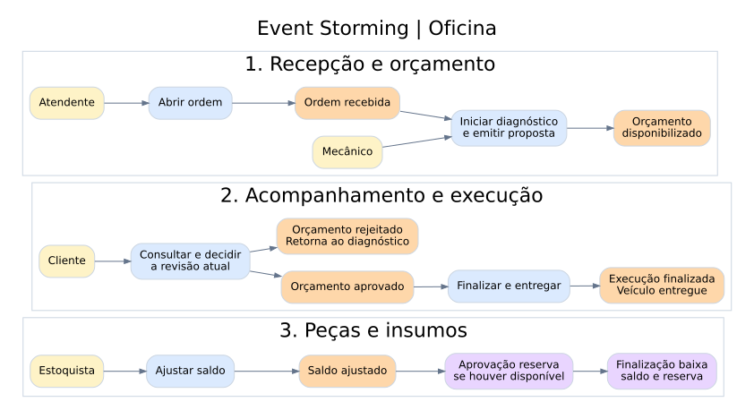
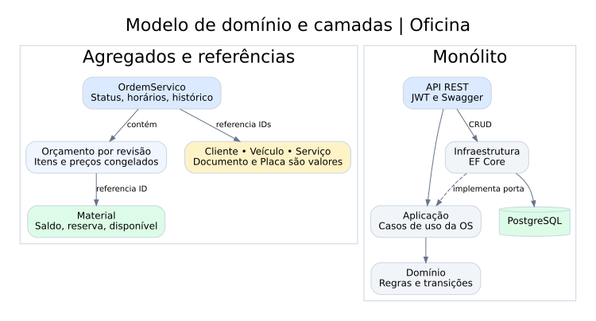

# DDD da oficina

## Event Storming

A conversa parte do carro no balcão. A primeira dúvida é quando comprometer peças. Orçar não mexe no saldo. A aprovação reserva os itens e a finalização baixa o que estava reservado. Outra decisão é tratar a rejeição como retorno ao diagnóstico, preservando a revisão que o cliente recusou.

**Legenda** · amarelo = ator · azul = comando · laranja = evento · roxo = política.

| Área | Ator | Comando | Evento | Regra aplicada |
|---|---|---|---|---|
| Criação | Atendente | Receber veículo | OrdemRecebida | Cliente identificado por documento, placa pertence a ele e existe serviço ativo. |
| Criação | Mecânico | Iniciar diagnóstico | DiagnosticoIniciado | A ordem precisa estar recebida. |
| Criação | Mecânico | Emitir orçamento | OrcamentoDisponibilizado | Calcula o total pelo catálogo e congela nomes, quantidades e preços da revisão. |
| Acompanhamento | Cliente | Consultar OS | Leitura sem alteração | ID e código precisam corresponder. |
| Acompanhamento | Cliente | Rejeitar revisão | OrcamentoRejeitado | Retorna a diagnóstico e guarda a decisão. |
| Acompanhamento | Cliente | Aprovar revisão | OrcamentoAprovado | A revisão deve ser a atual. A aprovação só é persistida se houver saldo disponível. |
| Estoque | Estoquista | Ajustar saldo | SaldoAjustado (conceitual) | A retirada manual deve preservar as reservas. |
| Estoque | Política da oficina | Reservar material | MaterialReservado (conceitual) | O disponível diminui junto com a aprovação da OS. |
| Estoque | Política da oficina | Baixar reserva | MaterialConsumido (conceitual) | A finalização reduz saldo e reserva na mesma transação. |
| Acompanhamento | Mecânico | Finalizar execução | ExecucaoFinalizada | Registra o fim e dá baixa nos materiais. |
| Acompanhamento | Atendente | Entregar veículo | VeiculoEntregue | Só uma ordem finalizada pode ser entregue. |

Os eventos da OS ficam registrados no histórico de `OrdemServico`. As mudanças de estoque são persistidas no agregado `Material`. Os nomes conceituais ajudam na modelagem do estoque e representam mudanças de estado, sem publicação de mensagens nesta fase.

## Agregados, contextos e código

| Área do domínio | Conceitos | Implementação |
|---|---|---|
| Atendimento | A OS é raiz do agregado. Orçamento por revisão, item de orçamento e evento são valores do seu histórico. | [OrdemServico.cs](../../src/Oficina.Dominio/OrdemServico.cs) e [Ordens.cs](../../src/Oficina.Aplicacao/Ordens.cs) |
| Cadastros | Cliente, veículo e serviço têm identidade própria. Documento e placa são objetos de valor. | [Cadastros.cs](../../src/Oficina.Dominio/Cadastros.cs) |
| Estoque | Material é uma raiz independente, com saldo, reserva e disponível. A OS o referencia por ID. | [Cadastros.cs](../../src/Oficina.Dominio/Cadastros.cs) |
| Persistência | A aprovação e a finalização atualizam dois agregados no mesmo banco. Cada agregado protege suas alterações por versão. | [OficinaDb.cs](../../src/Oficina.Infraestrutura/OficinaDb.cs) |

Atendimento, Cadastro e Estoque são fronteiras de linguagem dentro do monólito. A integração é feita por chamada de aplicação e IDs, com uma transação compartilhada para as políticas que cruzam Atendimento e Estoque. Atendimento possui o fluxo principal. Cadastros fornecem referências e o Estoque controla a disponibilidade.

Veja a [linguagem ubíqua](linguagem-ubiqua.md) para os termos usados nas rotas e na oficina.
